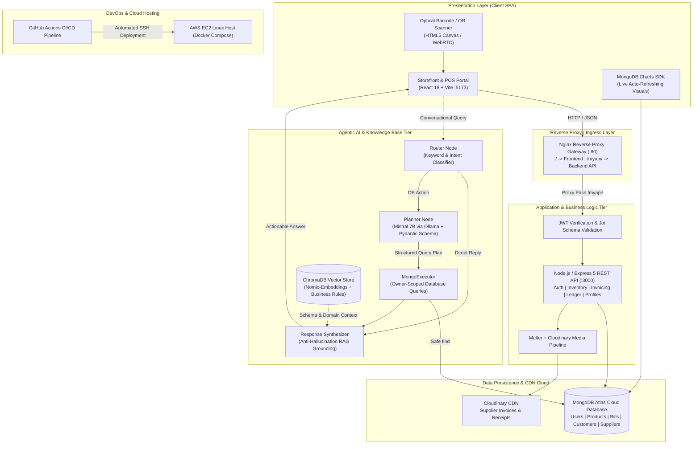
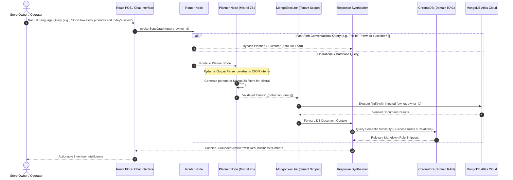
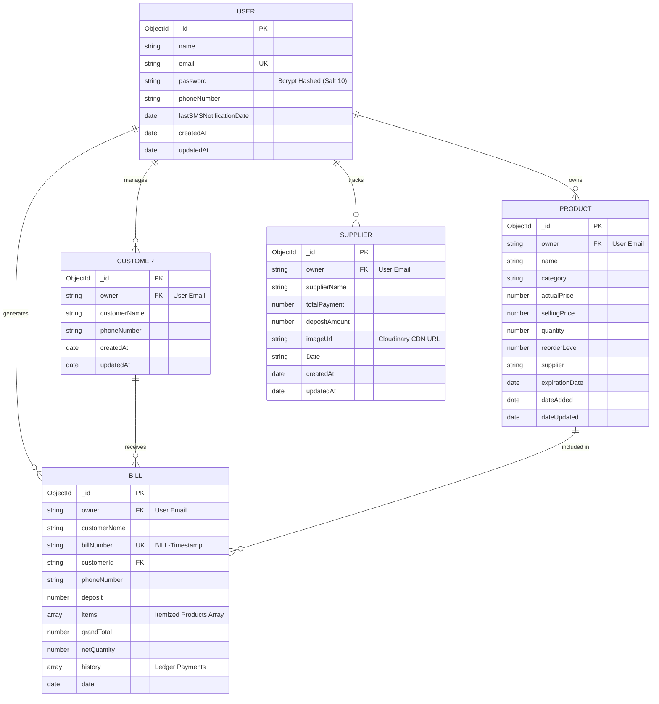

# 📦 Smart Inventory — AI-Powered Smart Inventory Management System & Point of Sale (POS)

[](https://reactjs.org/)
[](https://vitejs.dev/)
[](https://nodejs.org/)
[](https://expressjs.com/)
[](https://www.mongodb.com/)
[](https://www.python.org/)
[](https://langchain-ai.github.io/langgraph/)
[](https://www.trychroma.com/)
[](https://ollama.ai/)
[](https://www.docker.com/)
[](https://tailwindcss.com/)
[](https://cloudinary.com/)
[](https://aws.amazon.com/ec2/)

---

## 📌 Executive Summary

**Smart Inventory Management System (ShopManager)** is an enterprise-grade, full-stack retail operations and agentic business intelligence platform. Engineered to modernize traditional brick-and-mortar storefronts, wholesale distributors, and retail enterprises, it unifies fast-paced **Point of Sale (POS)** transactions with autonomous **Agentic AI** querying and credit ledger ("Khata") bookkeeping.

Powered by a microservice-ready MERN stack and a Python **LangGraph + ChromaDB RAG** engine, the system enables retail merchants to seamlessly scan barcodes via device cameras, process instant checkouts, monitor stockout risks in real time, track customer and supplier dues, view embedded live MongoDB analytics charts, and interrogate their database using natural language queries without writing SQL or Mongo aggregations.

---

## 🚀 Key Highlights & Engineering Capabilities

* **🤖 Autonomous Agentic AI & RAG Query Engine**: A multi-node StateGraph engine built on **LangGraph**, **ChromaDB**, and **Mistral 7B (via Ollama)** that translates natural language inquiries into schema-validated, tenant-isolated MongoDB queries with deterministic fallback routing and zero hallucinations.
* **📷 Hardware-Free Optical Barcode & QR POS Scanner**: Integrated in-browser camera scanning powered by `qr-scanner` that matches physical product barcodes against inventory in real time for frictionless checkout.
* **🛡️ Atomic Stock Depletion & Overselling Guard**: Transactional stock checking safeguards that verify product stock levels on the server before committing invoices, preventing negative inventory states.
* **🧾 Dual Thermal Receipt & Vector PDF Invoicing**: High-fidelity invoice generation with instant client-side printing (`react-to-print`) and vectorized PDF receipt downloads (`jspdf`).
* **👥 Customer & Supplier Khata (Credit Ledger) Tracking**: End-to-end ledger accounting with partial deposit history, payment method audit trails (Cash, Card, Digital), and supplier invoice document storage via **Cloudinary CDN**.
* **📊 Live Embedded Telemetry & MongoDB Charts**: Real-time business intelligence dashboard powered by `@mongodb-js/charts-embed-dom` with auto-refreshing KPI streams (stock vs. reorder thresholds, shelf-life expiration, daily sales).
* **🔐 Multi-Tenant Data Isolation by Design**: Multi-tenant database partitioning where every document is bound to an authenticated `owner` email via JWT and Joi schema validation.
* **🐳 Production-Grade Containerization & CI/CD**: Dockerized multi-stage builds orchestrating Vite, Express, and an Nginx reverse-proxy gateway, deployed automatically to **AWS EC2** via GitHub Actions.

---

## 🏗️ System Architecture



---

## 💻 Tech Stack Deep Dive

| Layer | Technologies | Justification & Use Case |
| :--- | :--- | :--- |
| **Frontend SPA** | React 18.3, Vite 6.2, Tailwind CSS 3.4, Ant Design (`antd`), Framer Motion, Lucide Icons | High-performance client with sub-second Hot Module Replacement, modular layout, responsive component transitions, and modern UI primitives. |
| **Hardware & POS** | `qr-scanner`, `react-qr-barcode-scanner`, `jspdf`, `react-to-print`, `react-datepicker` | Zero-hardware in-browser camera scanning, instant invoice thermal printing, vectorized PDF generation, and date-range filtering. |
| **Backend REST API** | Node.js 20.x, Express.js 5.1 (ES Modules), Mongoose 8, JWT, Joi, Bcrypt | Asynchronous event loop, strictly typed validation pipelines, secure password hashing, and stateless token-based authorization. |
| **Agentic AI & LLMs** | Python 3.10+, LangGraph, LangChain, Ollama (Mistral 7B), Pydantic V2 | Multi-node state machine enabling deterministic intent routing, structured MongoDB filter generation, and reliable autonomous planning. |
| **Vector DB & RAG** | ChromaDB, `nomic-embed-text` Embeddings | Persistent localized vector embeddings of shop schema relationships, calculation rules, and business guidelines for grounded generation. |
| **Database & CDN** | MongoDB Atlas, Cloudinary Cloud SDK, Multer | Horizontally scalable cloud document database, multipart image processing, and secure cloud storage for supplier invoices. |
| **Analytics & BI** | `@mongodb-js/charts-embed-dom` SDK | Embedded interactive dashboards displaying real-time financial telemetry, stock levels, and transaction distribution. |
| **DevOps & Ingress** | Docker, Docker Compose, Nginx (Alpine), Linux | Containerized multi-stage builds, reverse-proxy gateway routing `/` and `/myapi/`, caching, and isolated runtime environments. |
| **CI/CD Pipeline** | GitHub Actions (`deploy.yml`), SSH, Rsync, AWS EC2 | Zero-downtime automated deployment to production EC2 instances on every push to the `main` branch. |

---

## 🧠 Machine Learning & Agentic AI Architecture

The inventory intelligence module is engineered as an autonomous **LangGraph** StateGraph rather than an unstructured single-prompt chain. It eliminates hallucinations by decoupling reasoning, planning, and database execution.



### LangGraph State Machine Specifications
* **State Schema (`InventoryState`)**: Typed state tracking the incoming `query`, authenticated `owner_id`, dynamically generated `plan`, database payloads `db_results`, vector `rag_context`, and final `response`.
* **Deterministic Router (`router_node`)**: Evaluates keywords (`stock`, `bill`, `customer`, `supplier`, `price`, `expir`) to skip LLM overhead for non-data inquiries.
* **Pydantic Planner (`planner_node`)**: Prompts Mistral to emit structured JSON complying with a strict `Plan` model containing `Intent` arrays (`intent`, `collection`, `query`).
* **Multi-Tenant Injection-Proof Executor (`executor_node`)**: Enforces collection whitelisting (`products`, `bills`, `customers`, `suppliers`, `users`) and programmatically enforces `safe_query["owner"] = owner_id` before executing PyMongo queries.
* **Grounded Synthesizer (`response_node`)**: Applies strict anti-hallucination prompting: only numbers present in `db_results` may be uttered, returning *"No inventory data available"* when records are empty.

---

## 🌟 Core Application Modules

### 1. 🛒 POS & Camera Barcode Billing Terminal
* **In-Browser Barcode & QR Reader**: Scans physical barcodes via webcam or mobile camera to identify SKUs instantaneously.
* **Dynamic Cart Management**: Auto-calculates quantities, line-item totals, and net bill amounts.
* **Inventory Deduction**: Atomically validates stock availability and decrements inventory records upon transaction completion.
* **Print & Export**: Built-in thermal printer styling and vector PDF export for customer receipts.

### 2. 📦 Real-Time Inventory & Stock Lifecycle
* **SKU Intake & Cataloging**: Track product name, category, supplier, purchase cost (`actualPrice`), markup (`sellingPrice`), and shelf-life expiration date.
* **Reorder Level Monitoring**: Automated warning triggers when product count drops beneath configured threshold levels.
* **Instant Filter Search**: Multi-field regex search across product names, categories, and suppliers.

### 3. 👥 Customer Credit ("Khata") & Deposit Ledger
* **Credit Sale Tracking**: Support for deposit down-payments and ongoing customer debit balances.
* **Transaction History**: Audit trail logging payment dates, payment modes (Cash, Card, Digital), and installment history.
* **Customer Directory**: Central customer registry with quick phone lookup and balance summaries.

### 4. 🚚 Supplier Accounting & Cloud Document CDN
* **Supplier Ledger**: Log total purchase commitments, paid installments, and outstanding liabilities per vendor.
* **Cloudinary Receipt Storage**: Direct upload and storage of physical delivery notes and vendor paper invoices via Multer and Cloudinary Cloud CDN.

### 5. 📊 Live Business Intelligence & MongoDB Charts
* **Embedded Analytics SDK**: Live visual analytics rendered directly from MongoDB Atlas Charts.
* **Key Executive Visualizations**:
  * *Stock Levels vs. Reorder Thresholds* (Identifies impending stockouts).
  * *Expiration Date Monitoring* (Minimizes inventory spoilage and waste).
  * *Daily & Monthly Revenue Trajectories* (Tracks financial velocity).
  * *Top-Selling SKUs & Product Volume* (Optimizes purchasing strategy).

---

## 🗄️ Database Architecture & Schemas



---

## 📸 Screenshots Showcase

A visual walkthrough of the platform's multi-functional retail interfaces:

| POS Bill Generator & Optical Scanner | Real-Time Sales & Revenue Analytics |
|:---:|:---:|
|  |  |

| Dynamic Inventory Catalog & Search | Invoice Archive & Date Breakdown |
|:---:|:---:|
|  |  |

| Product Stock Intake & Pricing | Store Branding & System Overview |
|:---:|:---:|
|  |  |

---

## 🔌 API Reference Guide

### 🔐 Store Owner Authentication (`/api`)
| Method | Endpoint | Description | Access |
| :--- | :--- | :--- | :--- |
| `POST` | `/api/sign-up` | Register new store owner (`name`, `email`, `password`, `phoneNumber`) | Public |
| `POST` | `/api/login` | Authenticate merchant and issue signed JWT bearer token | Public |
| `GET` | `/api/profile` | Retrieve store profile information | Authenticated (JWT) |
| `PUT` | `/api/profile` | Update store contact details and business name | Authenticated (JWT) |

### 📦 Inventory Control (`/api/inventory`)
| Method | Endpoint | Description | Access |
| :--- | :--- | :--- | :--- |
| `POST` | `/api/inventory/add` | Create new SKU with reorder levels and supplier metadata | Authenticated (JWT) |
| `GET` | `/api/inventory/list` | Retrieve product list with optional `?search=` filter | Authenticated (JWT) |
| `PUT` | `/api/inventory/update-product/:id` | Update stock quantity, cost price, and selling price | Authenticated (JWT) |
| `DELETE`| `/api/inventory/delete/:id` | Remove SKU record from catalog | Authenticated (JWT) |

### 🧾 POS & Invoicing (`/api/bill`)
| Method | Endpoint | Description | Access |
| :--- | :--- | :--- | :--- |
| `POST` | `/api/bill/create` | Process cart, atomically decrement stock, issue bill | Authenticated (JWT) |
| `GET` | `/api/bill/getbill` | Fetch historical bills issued by authenticated owner | Authenticated (JWT) |
| `PUT` | `/api/bill/update/:billId` | Record incremental deposit payment against credit invoice | Authenticated (JWT) |
| `GET` | `/api/bill/dashdata` | Compute aggregated KPIs (daily sales, revenue, low stock) | Authenticated (JWT) |

### 👥 Customer Ledger (`/api/customer`)
| Method | Endpoint | Description | Access |
| :--- | :--- | :--- | :--- |
| `POST` | `/api/customer/add` | Onboard customer profile (`customerName`, `phoneNumber`) | Authenticated (JWT) |
| `GET` | `/api/customer/all` | List all registered customers under merchant account | Authenticated (JWT) |

### 🚚 Supplier Management (`/api/supplier`)
| Method | Endpoint | Description | Access |
| :--- | :--- | :--- | :--- |
| `POST` | `/api/supplier/supplier-data` | Log vendor purchase commitment with Cloudinary invoice upload | Authenticated (JWT) |
| `GET` | `/api/supplier/suppliers` | List all suppliers, payment history, and pending dues | Authenticated (JWT) |

### 🤖 Agentic AI Service (LangGraph Microservice)
| Channel | Function / Query | Description | Access |
| :--- | :--- | :--- | :--- |
| `CLI / Socket` | `graph.invoke({"query": "...", "owner_id": "..."})` | StateGraph execution returning grounded business intelligence | Tenant-Scoped |

---

## ⚙️ Local Installation & Development Setup

### 📋 Prerequisites
* **Node.js** v18+ or v20+ (`node -v`)
* **Python** 3.10+ (`python --version`)
* **Git** (`git --version`)
* **MongoDB Atlas** database connection URI
* **Cloudinary** account credentials
* **Ollama** installed with `mistral` and `nomic-embed-text` models

---

### Step 1: Clone the Repository
```bash
git clone https://github.com/shreejit550/Smart-Inventory-Management-System.git
cd Smart-Inventory-Management-System
```

---

### Step 2: Configure Environment Variables

#### 1. Backend (`backend/.env`)
```env
PORT=3000
MONGO_URL=mongodb+srv://<username>:<password>@cluster.mongodb.net/inventry
JWT_SECRET=your_super_secret_jwt_key
CLOUDINARY_NAME=your_cloudinary_cloud_name
CLOUDINARY_API_KEY=your_cloudinary_api_key
CLOUDINARY_API_SECRET=your_cloudinary_api_secret
```

#### 2. Frontend (`Frontend/.env`)
```env
backend_url=http://localhost:3000
```

#### 3. GenAI Agent (`GenAI/.env`)
```env
OLLAMA_URL=http://localhost:11434
LLM_MODEL=mistral
EMBED_MODEL=nomic-embed-text
MONGO_URI=mongodb+srv://<username>:<password>@cluster.mongodb.net/inventry
```

---

### Step 3: Start Services (Multi-Terminal Setup)

Open 3 separate terminal windows in your root directory:

#### 🖥️ Terminal 1 — Backend REST API
```bash
cd backend
npm install
npm run server
# Running on http://localhost:3000
```

#### 🖥️ Terminal 2 — GenAI Agent & RAG Pipeline
```bash
cd GenAI
python -m venv venv

# Windows:
.\venv\Scripts\activate
# macOS/Linux:
# source venv/bin/activate

pip install -r requirements.txt

# Ensure Ollama models are pulled
ollama pull mistral
ollama pull nomic-embed-text

# Build the vector store knowledge base
python rag/build_rag.py

# Launch interactive CLI agent
python main.py
```

#### 🖥️ Terminal 3 — Frontend Storefront & POS Portal
```bash
cd Frontend
npm install
npm run dev
# Running on http://localhost:5173
```

---

## 🐳 Docker Deployment Setup

The repository contains a production-grade multi-stage `dockerfile` and `docker-compose.yml` configuring an Nginx reverse proxy gateway routing traffic seamlessly between frontend and backend.

```bash
# Build and spin up containerized services
docker-compose up --build -d

# Check running container health
docker-compose ps

# Stream live container logs
docker-compose logs -f
```

* **Frontend Web Application:** `http://localhost/`
* **Backend API Gateway Proxy:** `http://localhost/myapi/`

---

## 🚢 CI/CD & Cloud Deployment (AWS EC2)

The application utilizes an automated Continuous Deployment pipeline configured in [`.github/workflows/deploy.yml`](.github/workflows/deploy.yml) that pushes updates live to an **AWS EC2** instance upon every merge to `main`.

```
 [ git push origin main ]
            │
            ▼
 ┌────────────────────────────────────────────────────────┐
 │             GitHub Actions Runner (Ubuntu)             │
 ├────────────────────────────────────────────────────────┤
 │ 1. Checkout repository code                            │
 │ 2. Decrypt & configure SSH private key                 │
 │ 3. Rsync project files to AWS EC2 instance             │
 └──────────────────────────┬─────────────────────────────┘
                            │
                            ▼
 ┌────────────────────────────────────────────────────────┐
 │                      AWS EC2 Host                      │
 ├────────────────────────────────────────────────────────┤
 │ • sudo docker compose down                             │
 │ • sudo docker compose build --no-cache                 │
 │ • sudo docker compose up -d                            │
 │ • sudo docker system prune -af (clean unused layers)   │
 └────────────────────────────────────────────────────────┘
```

---

## 🛡️ Security & Reliability Implementations

* **Multi-Tenant Strict Isolation**: Every database interaction filters explicitly by `owner: req.user.email`. Cross-tenant data leakage is structurally impossible.
* **Sanitized JSON Serialization**: Mongoose user schema transforms strip password hashes before transmitting user objects.
* **Input Schema Validation**: Joi middleware intercepts invalid request payloads prior to controller execution, preventing NoSQL injection.
* **Cryptographic Passwords**: Passwords hashed with `bcrypt` (10 salt rounds).
* **Network Encapsulation**: Docker internal bridge network keeps the Express API unexposed to public ports; external traffic flows exclusively through Nginx.

---

## 🔮 Future Roadmap & Scalability Enhancements

- [ ] **Automated WhatsApp / SMS Invoicing**: Integration with Twilio API to automatically dispatch digital receipts to customer phone numbers.
- [ ] **Predictive Demand Forecasting**: Time-series machine learning models analyzing seasonal trends to forecast required restock quantities.
- [ ] **Multi-Store & Warehouse Mesh**: Multi-branch inventory transfers and role-based staff permission tiers (Cashier, Store Manager, Auditor).
- [ ] **Offline-First PWA Synchronization**: Service Worker and IndexedDB caching enabling offline POS checkout during network disruptions.

---

## 📄 License & Attribution

This project is licensed under the **MIT License**. Developed as an advanced full-stack & Agentic AI retail solution.

---

<p align="center">
  <b>Built with ❤️ for modern retail inventory control & intelligent business automation.</b>
</p>
